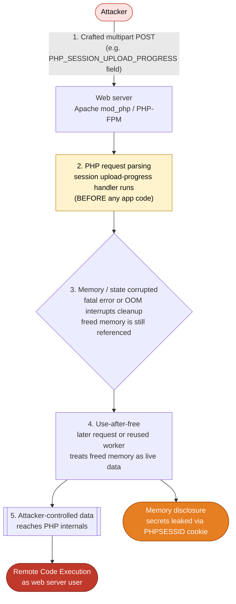

# PHP2Shell (CVE-2026-109618 / CVE-2026-109619)

> **Two critical, unauthenticated Remote Code Execution (RCE) bugs in PHP core.**
> Triggered while PHP parses a request, **before any application code runs.**


---

## TL;DR

| | |
|---|---|
| **Name** | PHP2Shell (named after a leaked exploit tool) |
| **CVEs** | CVE-2026-109618, CVE-2026-109619 |
| **Severity** | CVSS v4.0 **9.2 (Critical)** for both |
| **Impact** | Unauthenticated RCE as the web server user. CVE-2026-109618 can also leak server memory (passwords, session tokens, API keys, TLS keys) |
| **Attack vector** | A single crafted HTTP `POST` (multipart/form-data) |
| **Affected** | Every PHP release since **5.4** (2012) that is not patched |
| **Fix** | Upgrade to **8.5.12 / 8.4.27 / 8.3.36 / 8.2.35** (or a vendor backport) |
| **Quick mitigation** | Partial only. See [Mitigations](#-temporary-mitigations-not-a-fix) |

> **The only complete fix is updating PHP.** The PHP project states there are no complete mitigations.

---

## What is the vulnerability?

Both bugs are **memory-corruption flaws (use-after-free class)** inside PHP itself, not in your application code. That means a fully "secure" app on a vulnerable PHP runtime can still be taken over.

| CVE | Class | Impact |
|---|---|---|
| **CVE-2026-109618** | Out-of-memory (OOM) corruption. A fatal error interrupts native PHP code before cleanup | Remote memory disclosure and RCE |
| **CVE-2026-109619** | Stale state between requests, reached through the **session upload progress** feature (`session.upload_progress`) | RCE |

### Why it is so dangerous

- **Pre-auth:** no login, no valid session, no special app feature needed.
- **Pre-application:** the vulnerable code runs during request parsing, so it works even if your app never calls `session_start()`.
- **On by default:** `session.upload_progress.enabled` is `On` in stock PHP configs.
- **Memory leak:** CVE-2026-109618 can return freed worker memory inside a `PHPSESSID` response cookie, exposing secrets from *other* requests.
- **Works on common stacks:** RCE was confirmed against both **mod_php** and **PHP-FPM** (PHP-FPM exploitation depends on the app having an operation an attacker can make fail).

> **Note on CVE mapping:** early public write-ups mixed up which CVE covers which mechanism (many attributed upload-progress to CVE-2026-109618). Per PHP's own advisories, upload progress belongs to **CVE-2026-109619**, and the two bugs need **different stopgaps**. Treat the PHP advisories as the source of truth.

---

## How it works (simplified)



**In plain words:** PHP has a built-in feature that tracks file-upload progress in the session store. An attacker can send a request that makes PHP hit a fatal error (such as running out of memory) mid-operation. PHP skips its cleanup, leaving dangling pointers. The next request (or a reused worker) then uses that freed memory as if it were valid, and because the attacker influences what lands there, they can steer execution and run commands.

---

## Affected versions

**Every PHP version from 5.4 onward is considered exposed unless patched.** Branches below are from the public checker's ranges (as of 20 Oct 2026) and vendor advisories.

| PHP branch | Vulnerable range | Fixed version | Status |
|---|---|---|---|
| **8.5** | 8.5.0 to 8.5.11 | **8.5.12** | Patch available |
| **8.4** | 8.4.0 to 8.4.26 | **8.4.27** | Patch available |
| **8.3** | 8.3.0 to 8.3.35 | **8.3.36** | Patch available |
| **8.2** | 8.2.0 to 8.2.34 | **8.2.35** | Patch available |
| 8.1 | 8.1.0 to 8.1.34 | No upstream fix found | Check vendor backport or migrate |
| 8.0 | 8.0.0 to 8.0.30 | No upstream fix found | EOL, migrate |
| 7.4 | 7.4.0 to 7.4.33 | No upstream fix found | EOL, migrate |
| 7.3 | 7.3.0 to 7.3.33 | No upstream fix found | EOL, migrate |
| 7.2 | 7.2.0 to 7.2.34 | No upstream fix found | EOL, migrate |
| 7.1 | 7.1.0 to 7.1.33 | No upstream fix found | EOL, migrate |
| 7.0 | 7.0.0 to 7.0.33 | No upstream fix found | EOL, migrate |
| 5.6 | 5.6.0 to 5.6.40 | No upstream fix found | EOL, migrate |
| 5.5 | 5.5.0 to 5.5.38 | No upstream fix found | EOL, migrate |
| 5.4 | 5.4.0 to 5.4.45 | No upstream fix found | EOL, migrate |

> **Vendor backports matter.** Distros (Debian, Ubuntu, RHEL/Alma, etc.) may fix older version numbers without bumping them. Always compare your **full package revision** against your vendor's security advisory, not just `php -v`.

### Check your version

```bash
php -v                                        # CLI version (may differ from the web server's!)
php -i | grep -i 'upload_progress.enabled'    # On = attack surface active
```

> Verify the PHP that actually **serves your site** (Apache module or PHP-FPM), which can be a different build from the CLI.

---

## Timeline

| Date (2026) | Event |
|---|---|
| **20 Oct** | Details leak ahead of coordinated disclosure. RCE confirmed by researchers |
| **21 Oct, 14:00 UTC** | PHP releases 8.5.12, 8.4.27, 8.3.36, 8.2.35 |
| **21 Oct** | Exploitation attempts observed in the wild within hours, followed by automated scanning |

---

## Fix: update PHP

**Debian / Ubuntu**

```bash
sudo apt update && sudo apt install --only-upgrade 'php8.*'
```

Upgrade **all PHP packages together**, then restart your web stack (`apache2` / `php-fpm`).

**Docker**

Rebuild and redeploy using an image with PHP **8.2.35 / 8.3.36 / 8.4.27 / 8.5.12** or newer.

**Other environments:** do not forget embedded PHP (cPanel/Plesk, apps that bundle their own `php.exe`, containers, CI images).

---

## Temporary mitigations (not a fix)

Use these **only** until you can patch. They reduce risk but **do not cover all variants**, and each addresses a different bug.

| Mitigation | Helps with | Notes |
|---|---|---|
| `session.upload_progress.enabled = 0` | CVE-2026-109619 upload-progress path | Blocks confirmed session paths, not other variants |
| `memory_limit = -1` | CVE-2026-109618 (removes the controllable OOM condition) | Monitor memory use; restore the limit after patching |
| `fatal_error_backtraces = 0` | PHP 8.5 only | Interim mitigation published by PHP |

**Where to set them:** in `php.ini`, a drop-in file under `conf.d`, or the PHP-FPM pool config. **Not** via `ini_set()` or `.user.ini`, which take effect too late.

```ini
; php.ini or conf.d/99-php2shell.ini  (mod_php, restart Apache)
session.upload_progress.enabled = 0
```

```ini
; PHP-FPM pool, e.g. /etc/php/8.3/fpm/pool.d/www.conf  (set in every pool)
php_admin_flag[session.upload_progress.enabled] = off
```

PHP recommends leaving upload progress **off even after patching** if your app does not use it.

---

## Detection: are you being probed?

Look for these in WAF / application-layer logs (many CDN and access logs do not record request bodies):

- `multipart/form-data` **POST** requests to endpoints that normally do not accept uploads
- Requests containing the **`PHP_SESSION_UPLOAD_PROGRESS`** field name
- Scanner user agents such as `php2shell-scan/109618`, `php2shell-109618`, `php2shell-verify/1.0`
- Session files on disk containing unexpected `upload_progress_` entries
- Unexpected child processes spawned by the web server user, or new/modified files in web roots

**WAF idea:** block or alert on requests carrying the `PHP_SESSION_UPLOAD_PROGRESS` parameter on endpoints that do not need it.

### If you think you were compromised

1. Patch PHP first, then investigate.
2. **Rotate every secret** the PHP workers could have held: DB passwords, API keys, session secrets, TLS private keys.
3. Invalidate active sessions.
4. Review web roots and cron/systemd for persistence, and review outbound connections.
5. Rebuild from known-good images if integrity is in doubt.

---

## Quick checklist

- [ ] Inventory every PHP runtime (servers, containers, embedded, CI)
- [ ] Confirm the version **serving the site**, not just the CLI
- [ ] Upgrade to **8.5.12 / 8.4.27 / 8.3.36 / 8.2.35**, or a vendor-patched package
- [ ] Migrate off EOL branches (8.1 and below)
- [ ] Apply interim mitigations where patching must wait
- [ ] Add WAF/log detection for `PHP_SESSION_UPLOAD_PROGRESS`
- [ ] Rotate secrets if exposure is possible

---

## References

- PHP 8.4.27 release notes: https://github.com/php/php-src/releases/tag/php-8.4.27
- PHP advisory (CVE-2026-109618): https://github.com/php/php-src/security/advisories/GHSA-w8hw-w9fx-j79w
- Sophos advisory: https://www.sophos.com/en-us/security-advisories/sophos-sa-20261021-php2shell
- AlmaLinux patch announcement: https://almalinux.org/blog/2026-10-21-php2shell-cve-2026-109618-cve-2026-109619/
- Sansec research: https://sansec.io/research/php2shell
- ELLIO field observations: https://ellio.tech/en/blog/php2shell-what-we-observed-and-what-to-do/
- Version checker (read-only, no exploit probes): https://github.com/openai/php2shell-checker

---

## Disclaimer

This document is for **defensive and educational purposes**. It contains no exploit code. Test only systems you own or have explicit permission to assess. Details evolved quickly after the leak, so confirm against the official PHP advisories and your vendor before acting.
